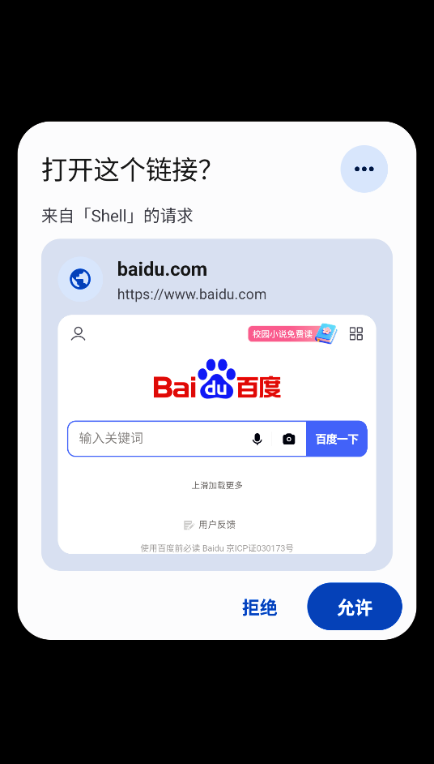

# LinkGuard · 链接守卫

> 别的应用想打开链接时，先问你一句。
> *When another app wants to open a link, it asks you first.*

接管系统默认浏览器角色的 Android 工具：拦截其它应用发起的 `http` / `https` 跳转，弹窗让你决定放行还是拦下。
*An Android utility that takes over the system default-browser role — it intercepts `http` / `https` jumps from other apps and asks you what to do.*

<p align="center">
  
  
  
</p>

<p align="center">
  
  
  
  
</p>

---

# 中文

## 它解决什么

安卓上点一个链接，经常被直接甩进某个 App 的内置浏览器或广告页，你连跳去了哪儿都没看清。
LinkGuard 注册成系统默认浏览器后，**所有 `http` / `https` 跳转都先经过它**，由你决定这一跳要不要放行。

## 拦截弹窗

被拉起时**不显示应用界面，只弹窗**：

```
打开这个链接？                    (⋯)
来自「Shell」的请求

┌────────────────────────────────┐
│ 🌐  baidu.com                  │
│     https://www.baidu.com      │
│ ╭────────────────────────────╮ │  ← 实时预览
│ │   [真实渲染的网页缩略图]     │ │     只读，点不动
│ ╰────────────────────────────╯ │
└────────────────────────────────┘
                    拒绝   ( 允许 )
```

- **拒绝** — 不打开，记一条日志
- **允许** — 用默认浏览器打开
- **⋯** — 展开「更多」面板

## 「更多」面板

顶部的小白条**可以上下拖**。收起档只露最常用的三个处置动作，展开档放出全部设置。

| 记住选择 | 预览 |
| --- | --- |
| ✓ 总是允许（加白名单） | 📄 网页预览 `[开关]` |
| ⊘ 总是拦截（加黑名单） | 🔍 预览缩放 `默认 60%` |
| 📵 屏蔽「某应用」（红） | |

底部单独一行：**打开应用主页面**

## 功能

| 功能 | 说明 |
| --- | --- |
| **黑名单** | 匹配的网址直接拦下，只留一条系统小字提示 |
| **白名单** | 匹配的网址直接放行，可指定用哪个浏览器 |
| **屏蔽应用** | 某个应用拉起的链接全部拦下，最强一级 |
| **浏览记录** | 放行 / 拦截 / 拒绝都有记录，可搜索 |
| **实时预览** | 打开前先看网页真容；WebView 渲染但完全不可操作 |
| **预览缩放** | 25–200% 任意输入，默认 60% |
| **7 套配色** | 默认蓝 / 紫罗兰 / 青碧 / 森林绿 / 暖橙 / 玫红 / 深色 |
| **中英双语** | 语言包独立，加语言只要丢一个 JSON |

## 语言包

文案不在 `res/values-xx` 里，而在 `assets/lang/<code>.json`：

```
assets/lang/
├── zh.json   189 条
└── en.json   189 条
```

加一种语言 = **往这个目录丢一个 JSON**，不用改资源、不用碰代码。占位符用 `{0}` `{1}`。

## 安装

下载 [Releases](../../releases) 里的 APK，安装后在首页点「设为系统默认浏览器」。

- **Android 10+** — 直接弹出系统授权框
- **Android 9 及以下** — 跳到系统设置，手动选「打开支持的链接 → 始终」

## 构建

没有用 Gradle，直接驱动 SDK 工具链：

```powershell
.\build.ps1
```

流程：`aapt2 compile/link` → `javac` → 打包 jar → `d8` → 注入 `classes.dex` → `zipalign` → `apksigner`

## 隐私

- 联网**只用于拦截弹窗里的网页实时预览**，除此之外没有任何网络行为
- 黑名单、白名单、浏览记录、全部配置都只存在本机 `SharedPreferences`
- 不上传任何数据，没有统计、没有账号

---

# English

## What it solves

Tapping a link on Android often dumps you straight into some app's built-in browser or an ad page — you never even see where you're going.
Once LinkGuard registers as the system default browser, **every `http` / `https` jump goes through it first**, and you decide whether to let it pass.

## The intercept dialog

Every time another app tries to open a link, LinkGuard shows **only a dialog, never the app UI**:

- **Deny** — don't open it; logged
- **Allow** — open with your default browser
- **⋯** — open the "More" sheet

## The "More" sheet

Drag the handle at the top to resize it. The collapsed detent shows only the three most-used actions; expand it for everything else.

| Remember | Preview |
| --- | --- |
| ✓ Always allow (whitelist it) | 📄 Web preview `[toggle]` |
| ⊘ Always block (blacklist it) | 🔍 Preview zoom `60% by default` |
| 📵 Block "some app" (red) | |

And a standalone row at the bottom: **Open app home screen**

## Features

| Feature | Description |
| --- | --- |
| **Blacklist** | Matching URLs are dropped with only a small system toast |
| **Whitelist** | Matching URLs open straight away, optionally in a specific browser |
| **App blocking** | Every link from that app is blocked — the strongest tier |
| **History** | Allows, blocks and denials are all logged and searchable |
| **Live preview** | See the real page before deciding; rendered but completely non-interactive |
| **Preview zoom** | Any value from 25% to 200%, 60% by default |
| **7 color schemes** | Blue / Purple / Teal / Green / Orange / Pink / Dark |
| **Bilingual** | Language packs are standalone — adding one means dropping in a JSON file |

## Language packs

Strings don't live in `res/values-xx` but in `assets/lang/<code>.json`. Adding a language means **dropping one JSON file into that folder** — no resource changes, no code changes. Placeholders use `{0}` and `{1}`.

## Install

Download the APK from [Releases](../../releases), install it, then tap **Set as default browser** on the home screen.

- **Android 10+** — the system role dialog appears directly
- **Android 9 and below** — you're taken to system settings; pick the browser manually

## Build

No Gradle — the SDK toolchain is driven directly:

```powershell
.\build.ps1
```

Pipeline: `aapt2 compile/link` → `javac` → jar → `d8` → inject `classes.dex` → `zipalign` → `apksigner`

## Privacy

- Network access is used **only for the live preview inside the intercept dialog**; there is no other network activity
- Blacklist, whitelist, history and all settings live solely in local `SharedPreferences`
- Nothing is uploaded; no analytics, no accounts

---

## 设计 · Design

界面按 **Material Design 3** 手工实现（没有引入 AndroidX）：

- 形状标度 4 / 8 / 12 / 16 / 20 / 28 / 32 / 48 / full
- 颜色按 M3 中性色调阶梯生成：底色 → 卡片 → 嵌套容器，每级 7–9 个明度点
- 弹窗 `CornerExtraLarge` 28dp，列表 `CornerLarge` 16dp，卡片 `CornerMedium` 12dp
- 标题用 **Afacad Flux** 渲染成矢量图，随主题着色

The UI is hand-built to **Material Design 3** (no AndroidX):

- Shape scale 4 / 8 / 12 / 16 / 20 / 28 / 32 / 48 / full
- Colors follow the M3 neutral tonal ladder: page → card → nested container, 7–9 lightness points apart
- Dialogs at `CornerExtraLarge` 28dp, lists at `CornerLarge` 16dp, cards at `CornerMedium` 12dp
- The wordmark is **Afacad Flux** rendered to a vector, tinted by the theme

## 兼容性 · Compatibility

| | |
| --- | --- |
| minSdk | **21**（Android 5.0） |
| targetSdk | 36 |
| 实测 / Tested | Android 15 (API 35) · Android 7.1.2 (API 25) |
| 依赖 / Deps | 无 AndroidX、无 Gradle、无第三方库 |

---

## 致谢 · Credits

- **作者 / By** — [micr-07](https://github.com/micr-07) · DeepSeek
- **邮箱 / Email** — dogoolge@126.com
