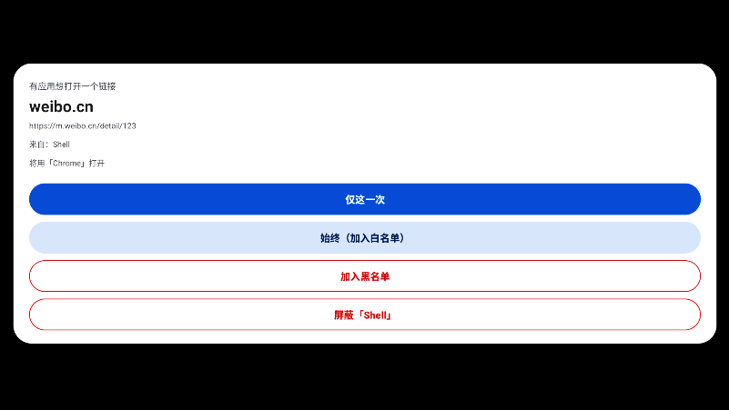
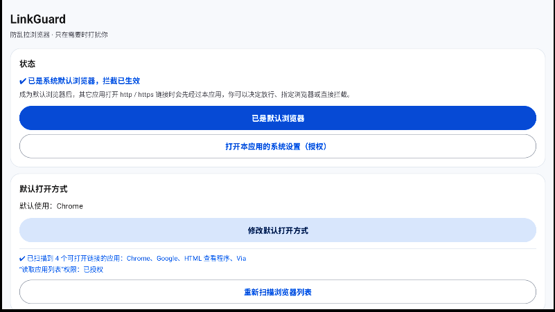

# LinkGuard

一个「防乱拉浏览器」的 Android 应用：把自己注册成系统默认浏览器，接管其它应用发起的
`http` / `https` 跳转，由你来决定**放行、指定浏览器、还是直接拉黑**。

被拉起时**不进入应用界面**，只弹一张浮层卡片；拉黑的网址什么都不弹，只用系统小字提示一下。
黑名单 / 白名单 / 应用屏蔽三份名单各自独立成页，都带搜索。

产物：`LinkGuard-v2.0.apk`（约 227 KB，minSdk 29 / Android 10，targetSdk 36）

| 拦截弹窗 | 主界面 |
| :---: | :---: |
|  |  |

**特性速览**

* 纯 Java + 原生 View，**不依赖 AndroidX / Gradle**，整个 APK 只有 227 KB
* Material 3 风格界面，7 套可切换配色（含深色）
* 完整的中文说明，含故障排查（vivo / 小米等国产 ROM 的权限坑）
* 不联网、不申请多余权限，所有数据只存在本机 `SharedPreferences`

---

## 一、功能

### 1. 被拉起时只弹窗，不进入应用界面

被任何应用拉起时，屏幕上出现的是一个**浮层卡片**（不是应用主界面）：

```
        有应用想打开一个链接
        来自：某某 App
        ┌──────────────────────┐
        │      example.com     │   ← 根网址
        │  https://example.com/…│
        └──────────────────────┘
        [ 仅这一次 ]
        [ 始终（加入白名单） ]
        [ 加入黑名单 ]
        [ 屏蔽「某某 App」 ]        ← 能识别出来源应用时才出现
```

* **仅这一次** → **直接用「默认打开方式」里的浏览器打开**，什么都不记住。不会再问你选浏览器。
* **始终（加入白名单）** → 只点这一下就够了：把这个网址**加进白名单**，并**立刻用默认浏览器打开**。
  以后这个网站都直接开，不再询问。想给某个网址单独指定浏览器（**特例**），到白名单页面里点那一行设置。
* **加入黑名单** → 该网址直接被拦下（同时会把它从白名单移走）。
* **屏蔽「某某 App」** → 把这个来源应用加进「应用屏蔽」名单，它以后拉起的所有链接都会被拦下。

弹窗里会直接写明「**将用「Chrome」打开**」，不用猜它到底会怎么处理。

> 如果还没在设置里选过默认浏览器，弹窗会提示「还没设置默认浏览器，打开前会让你选一个」，
> 点两个按钮中的任何一个都会让你先选一个**只用于本次**的浏览器（因为此时不知道该用哪个开）。
> 去设置里选一次，之后就完全不用再管了。

### 2. 三份名单，各自独立界面

主界面只放状态和设置入口，名单都拆成了单独页面，每个页面都带**搜索框**：

| 页面 | 作用 | 搜索 |
| --- | --- | --- |
| **黑名单** | 命中的网址直接丢弃，只用系统小字提示，什么界面都不弹 | ✔ 按网址搜索 |
| **白名单** | 命中的网址**直接打开**，不再询问；用哪个浏览器跟随全局「默认打开方式」 | ✔ 按网址搜索 |
| **已屏蔽的应用** | 勾选后，该应用拉起的所有链接一律拦下 | ✔ 按应用名 / 包名搜索 |
| **浏览记录** | 最近 100 条「拦截 / 打开」记录 | ✔ 按网址搜索 |

**白名单只有「特例」才需要指定浏览器**：默认所有白名单网址都跟随全局默认浏览器
（列表里显示为「跟随默认浏览器」）。想给某个网址单独指定，点那一行 →「指定浏览器（特例）…」，
选完就变成「固定使用 XXX」。也可以在那里选回「不指定，使用默认浏览器」取消特例。

点「添加白名单网址」只负责加进名单，不会弹浏览器选择框 —— 需要特例再点那一行。

黑名单和白名单支持互相「移到…」，添加时会自动从对方名单里移除，不会同时出现在两边。

### 3. 黑名单 / 应用屏蔽：什么都不做，只用系统小字提示

命中时**不会出现任何可见界面**（弹窗主题是透明的全屏窗口，里面什么都没有），
只会用系统 Toast 提示 `已拦截：xxx.com` 或 `已屏蔽 xxx 拉起的链接`，不打开任何浏览器、也不跳转任何页面。

> 实现细节：弹窗用的 `InterceptTheme` 是 `windowIsTranslucent + 透明背景`，
> 拦截分支不调用 `setContentView()`，所以窗口里什么都没有，
> 提示完立刻 `finish()`，用户只会看到一闪而过的小字。

### 4. 路由顺序

```
来源应用在「应用屏蔽」里？  → 拦下
  ↓ 否
网址在「黑名单」里？        → 拦下
  ↓ 否
网址在「白名单」里？        → 用指定浏览器（没指定就用默认）直接打开
  ↓ 否
关掉了「弹窗询问」且设了默认浏览器？ → 直接用默认浏览器打开
  ↓ 否
弹窗询问
```

### 5. 根网址归并

弹窗里显示的是「根网址」，子域名会归并到同一个站点：

| 实际网址 | 根网址 |
| --- | --- |
| `m.taobao.com` / `www.taobao.com` | `taobao.com` |
| `news.sina.com.cn` | `sina.com.cn` |
| `a.b.example.co.uk` | `example.co.uk` |

内置了常见的二级公共后缀表（`com.cn` / `co.uk` / `co.jp` / `com.hk` …），
所以 `m.taobao.com.cn` 会正确归到 `taobao.com.cn` 而不是 `com.cn`。

### 6. 桌面设置界面

* **状态**：显示当前是否已是系统默认浏览器；一键申请（Android 10+ 用 `RoleManager`
  的浏览器角色，失败时回落到系统「默认应用」设置页）；另有「打开本应用的系统设置」用于授权。
* **默认打开方式**：默认用哪个浏览器打开，或选择「不指定，使用默认浏览器」。
* **浏览器扫描结果**：直接显示扫到几个浏览器、以及「读取应用列表」权限是否正常。
* **开关**：
  * **被拉起时先弹窗询问** —— 打开（默认）时不在任何名单里的网址会弹窗问你；
    关闭后直接**用默认浏览器打开**，全程无感（没有默认浏览器时仍会弹窗，否则链接就打不开了）。
  * **拦截时用系统小字提示我**。
* **名单管理**：黑名单 / 白名单 / 已屏蔽的应用 / 浏览记录，按钮上直接带条目数。
* **外观**：7 套 Material 3 配色方案，点一下立刻生效（见下）。

### 7. Material 3 界面 + 可调配色

界面按 Material 3 重做：大圆角卡片（20dp / 弹窗 28dp）、胶囊按钮（filled / tonal /
outlined 三级层次）、填充式搜索框、自绘顶部应用栏、MD3 排版层级。

设置页「外观」里提供 7 套配色，选中即刻应用（含拦截弹窗，弹窗配色独立跟随）：

| 方案 | 主色 |
| --- | --- |
| 默认蓝 | `#0B57D0` |
| 紫罗兰 | `#6750A4`（Material 3 基线色） |
| 青碧 | `#00696D` |
| 森林绿 | `#3B6939` |
| 暖橙 | `#8B5000` |
| 玫红 | `#9C4059` |
| 深色 | `#A8C7FA` on `#101014` |

实现方式：在 `attrs.xml` 里自定义了一组 MD3 颜色角色（`lgPrimary` / `lgSurface` /
`lgOnSurfaceVariant` / `lgDanger` …），每套配色就是一组主题赋值；布局和 drawable 全部引用
`?attr/lgXxx`，所以换配色只需换主题，不碰任何控件代码。

### 8. 应用图标

**纯扁平、纯色拼搭**（无渐变、无柔光、无投影）：纯蓝底 + 白色链环 `/` + 红色圆头斜杠 `\`，
两者**垂直相交** —— 「链接被拦下」。蓝底用的是 `#2563EB`，和 App 默认配色一致。

图标有两套，都由 `tools/make_icon.py` 用 Pillow 生成：

* **自适应图标**（`mipmap-anydpi-v26/`，Android 8+ 实际使用）：背景层是纯色位图，
  前景层是透明底的图形，内容收在中间安全区内，由启动器自行套用圆形 / 圆角遮罩。
* **传统位图**（`mipmap-{mdpi..xxxhdpi}/ic_launcher.png` + `ic_launcher_round.png`）：
  满幅圆角方形和圆形版本，作为兜底。

**换风格只要跑一条命令**，脚本会重新生成全部密度的图标：

```bash
python tools/make_icon.py blue-link-bar   # 默认：蓝底 + 白链环 + 红杠
python tools/make_icon.py green-shield    # 白底 + 绿盾 + 白链环（AdGuard 那种）
python tools/make_icon.py blue-shield     # 白底 + 蓝盾 + 白链环
python tools/make_icon.py white-link-bar  # 白底 + 蓝链环 + 红杠
```

每种风格各带一组缩放比例：盾牌本身铺满画布，前景取 0.72；链环 + 红杠的实际外接框
只有画布的 ~0.72，前景要放大到 0.86 才不显小。

> 注意链环的倾斜方向和红杠是**垂直**的（链环 `/`、红杠 `\`）。早期版本把链环转错了方向，
> 结果它和红杠几乎平行，看着很别扭 —— 现在 `ring()` 里传的是负角度（顺时针）。

---

## 二、安装与使用

1. 把 `LinkGuard-v2.0.apk` 传到手机安装（需要允许「安装未知来源应用」）。
2. 打开「LinkGuard」→ 点 **设为系统默认浏览器** → 在系统弹窗里确认。
   * 部分国产 ROM 还需要在 *系统设置 → 应用管理 → 默认应用 → 浏览器* 里手动选择「LinkGuard」。
3. 之后任何应用拉起链接，都会先经过本应用。

用 adb 安装：

```powershell
adb install -r LinkGuard-v2.0.apk
```

卸载 / 恢复原来的默认浏览器：[系统设置 → 应用 → 默认应用 → 浏览器] 里改回原来的浏览器即可。

---

## 三、故障排查：弹窗里列不出浏览器

**现象**：能设为默认浏览器，但点开「仅这一次 / 始终」后，列表里没有 Chrome、夸克等。

**原因**：Android 11 起有「包可见性」限制，应用默认只能看到自己；vivo / OPPO / 小米等
ROM 还把它包成一道「读取应用列表」权限。被限制时 `queryIntentActivities()` 直接返回空列表。

v1.1 起已经做了四层处理，正常情况下不需要手动做什么：

| 层 | 做法 |
| --- | --- |
| 1 | 申请 `QUERY_ALL_PACKAGES`（安装即授予的普通权限，等于解除过滤） |
| 2 | `<queries>` 里声明 **不带 category 的 `ACTION_VIEW` + http/https 意图** —— 见下，这一条才是覆盖「所有浏览器」的关键 |
| 3 | 再逐个显式声明 58 个常见浏览器包名（含 Via、X 浏览器、夸克、UC、QQ、百度、各厂自带、Firefox、Edge、Brave、Vivaldi…） |
| 4 | 仍枚举不到时，按内置包名清单逐个探测，再用 `setPackage` 直接拉起（**启动**不受可见性限制） |
| 5 | 列表最后一项「其它浏览器（系统打开方式）」把链接交回系统选择器，任何情况下都能用 |

**为什么第 2 层能覆盖"所有浏览器"**：包可见性的匹配规则是「目标应用的 intent-filter
必须包含查询意图声明的全部 category」。查询意图**不带 category**，就等价于对 category
没有任何要求，于是所有能处理 `http`/`https` `VIEW` 的应用都会变得可见 ——
包括 Via、X 浏览器这类没有被我硬编码进名单的浏览器。

> v1.3 修复：之前只声明了带 `CATEGORY_BROWSABLE` 的版本，导致个别浏览器的 intent-filter
> 写法对不上而扫描不到（例如 Via）。现在同时声明了不带 category 的宽松版本。

如果前两层被 ROM 拦掉了（列表依旧为空），设置页会直接写明：

```
✘ 没有扫描到浏览器：系统当前只让本应用看到 N 个已安装应用
“读取应用列表”权限：未授权，可能就是列表为空的原因
```

这时点设置页的 **打开本应用的系统设置（授权）**，在权限里允许「读取应用列表 / 获取应用列表」：

* **vivo / iQOO（OriginOS）**：设置 → 应用与权限 → 权限管理 → 权限 → **读取应用列表** → LinkGuard → 允许
  （或在 i 管家 → 权限管理 → 读取应用列表）
* **OPPO / 一加 / 真我（ColorOS）**：设置 → 应用 → 应用管理 → LinkGuard → 权限 → **读取应用列表**
* **小米 / 红米（MIUI / HyperOS）**：设置 → 应用设置 → 应用管理 → LinkGuard → 权限管理 → **获取应用列表**

允许后回到设置页点「重新扫描浏览器列表」即可恢复。即使不授权，弹窗里的「系统打开方式」也始终可用。

---

## 四、自己重新构建

不依赖 Gradle、不联网，只用 Android SDK 的构建工具链：

```powershell
cd LinkGuard
powershell -ExecutionPolicy Bypass -File build.ps1
```

脚本会自动完成：生成图标 → `aapt2 compile/link` → `javac`（JDK 21，`-source 8`）→ `d8`
→ 写入 `classes.dex` → `zipalign` → `apksigner` 签名 → 校验，最后输出
`LinkGuard-v2.0.apk`。

> 注意：`build.ps1` 里有中文，必须保存成 **UTF-8 with BOM**，否则 Windows PowerShell 5.1
> 会按 GBK 解析而报语法错。若用编辑器改过该文件，先执行一次：
> `[IO.File]::WriteAllText($p, (Get-Content -Raw -Encoding UTF8 $p), (New-Object Text.UTF8Encoding $true))`

可覆盖的参数：

```powershell
.\build.ps1 -Sdk "D:\Android\Sdk" -Jbr "C:\Program Files\Android\Android Studio\jbr" `
            -Python "python" -Platform android-36.1 -BuildTools 36.1.0 -MinSdk 29
```

### 签名

首次构建时如果 `keystore/linkguard.jks` 不存在，脚本会自动用 `keytool` 生成一个
（别名 `linkguard`，有效期 30 年），信息记录在 `keystore/keystore-info.txt`。

> ⚠️ **仓库里不含签名文件**（`.gitignore` 已排除 `keystore/`）—— 签名密钥泄漏等于别人可以
> 冒名发布覆盖安装包。你 clone 下来首次构建会自动生成**你自己的** keystore。
>
> 也正因为签名不同，**自己构建的 APK 无法覆盖安装本仓库提供的 `LinkGuard-v2.0.apk`**，
> 需要先卸载。想无缝升级就自己固定一个 keystore 并妥善保管。

### 目录结构

```
LinkGuard/
├─ AndroidManifest.xml          声明默认浏览器角色 + QUERY_ALL_PACKAGES + <queries> 包声明
├─ build.ps1                    一键构建脚本
├─ keystore/linkguard.jks       签名证书（请保留）
├─ res/
│  ├─ layout/                   activity_main / activity_list / dialog_intercept / item_choice / item_list_row
│  ├─ values/                   strings / colors / attrs（MD3 颜色角色）/ styles（7 套配色 + 组件样式）
│  ├─ drawable/                 md_card / md_btn_* / md_field / ic_back
│  └─ mipmap-*/ic_launcher.png  由 tools/make_icon.py 生成
├─ src/com/linkguard/browser/
│  ├─ InterceptActivity.java    被拉起时的入口：应用屏蔽 / 黑名单 / 白名单 / 弹窗
│  ├─ MainActivity.java         桌面设置界面
│  ├─ BlacklistActivity.java    黑名单页（带搜索）
│  ├─ WhitelistActivity.java    白名单页（带搜索 + 指定浏览器）
│  ├─ AppBlockActivity.java     已屏蔽的应用页（带搜索）
│  ├─ LogActivity.java          浏览记录页（带搜索）
│  ├─ ListActivityBase.java     四个列表页共用的骨架
│  ├─ RowAdapter.java           通用列表适配器（图标 / 两行文字 / 勾选 / 删除）
│  ├─ Lists.java                黑名单 / 白名单 / 应用屏蔽的存储 + 旧数据迁移
│  ├─ Themes.java               MD3 配色方案的注册与套用
│  ├─ HostUtil.java             根网址提取
│  ├─ LogStore.java             最近记录
│  ├─ BrowserCatalog.java       枚举可打开链接的浏览器（四层回退 + 包可见性诊断）
│  ├─ LaunchHelper.java         把链接交给指定浏览器 / 交回系统选择器
│  ├─ Dialogs.java              共用的输入与选择对话框
│  ├─ Prefs.java                全局设置
│  └─ Target.java               浏览器条目
└─ tools/
   ├─ make_icon.py              生成各密度图标
   └─ adddex.py                 追加 classes.dex（保证 resources.arsc 仍是 STORED）
```

> 上面这两个脚本是 `build.ps1` 的一部分，构建时会自动调用，缺一不可。

---

## 五、实测记录（MuMu 模拟器 / Android 15）

在 MuMu 模拟器（**Android 15 / API 35**，1920×1080）上真机安装并跑通了全部主流程，
共 **24 项断言全部通过**（弹窗三个分支 + 三份名单 + 白名单特例）。

**弹窗与名单主流程：**

| # | 场景 | 结果 |
| --- | --- | --- |
| 1 | 在设置里选好默认浏览器 = Chrome | ✔ |
| 2 | 其它应用拉起链接 → 弹出询问窗并显示根网址 | ✔ |
| 3 | 点「加入黑名单」后再次打开同一网址 → 完全静默 | ✔ |
| 4 | 弹窗里写明「将用「Chrome」打开」 | ✔ |
| 5 | 点「仅这一次」→ **没有再弹浏览器选择** | ✔ |
| 6 | 直接用默认浏览器 Chrome 打开 | ✔ |
| 7 | 「仅这一次」不写名单：同一网址再触发仍然弹窗 | ✔ |
| 8 | 点「始终（加入白名单）」→ **没有再弹浏览器选择** | ✔ |
| 9 | 白名单网址再次打开 → 不再询问，直接开 | ✔ |
| 10-12 | 点「屏蔽「Shell」」后该应用再拉链接 → 被拦下 | ✔ |
| 13-15 | 三份名单的条目数分别为 2 / 1 / 1 | ✔ |

**白名单语义与特例：**

| # | 场景 | 结果 |
| --- | --- | --- |
| 16-19 | 点「始终」→ 不弹浏览器选择 → 用默认浏览器打开 → 之后不再询问 | ✔ |
| 20 | 白名单条目显示「跟随默认浏览器」 | ✔ |
| 21 | 点该行 →「指定浏览器（特例）…」→ 选 Via → 变成「固定使用 Via」 | ✔ |
| 22 | 再触发 → **走 Via 而不是默认的 Chrome**（特例生效） | ✔ |
| 23 | 设置默认浏览器后，「被拉起时先弹窗询问」开关**仍然保持开启** | ✔ |
| 24 | 兜底：没设默认浏览器时，弹窗提示会变成「打开前会让你选一个」 | ✔ |

另外用 `adb shell cmd role add-role-holder android.app.role.BROWSER com.linkguard.browser`
把它设为系统默认浏览器后，用 `am start -a android.intent.action.VIEW -d <url>` 发**真实系统跳转**，
确认链接确实被系统路由到本应用，并按名单处理（该场景下因为 Shell 已被屏蔽，链接被静默拦下）。

这一轮实测确认 / 修掉的问题：

* **Via 能被正确扫描到** —— v1.3 那个「不带 category 的 `<queries>` 意图」的修复确实有效。
* 来源应用识别在 Android 15 上工作正常（`getLaunchedFromPackage()`），弹窗里能显示「来自：XXX」
  并给出「屏蔽「XXX」」按钮。
* 7 套配色切换即时生效（含深色），弹窗配色跟随。
* **修掉一个隐蔽 bug（v1.9）**：以前在设置里选一次默认浏览器，会**顺手把「被拉起时先弹窗询问」
  这个开关关掉**（`MainActivity.showPickDefaultDialog` 里的 `Prefs.setShowDialog(false)`）。
  而白名单又必须先设默认浏览器才生效 —— 结果就是设完之后再也不弹窗，名单等于失效。
  现在两者完全独立：默认浏览器决定「用哪个打开」，开关决定「要不要问」。

---

## 六、已知限制

* 必须被设为**系统默认浏览器**才会生效；Android 的机制决定了第三方应用无法在不成为
  默认浏览器的情况下接管全局链接跳转。
* 少数应用用「应用内 WebView / Custom Tabs」直接打开链接，不会经过系统跳转，
  这类情况本应用无法拦截 —— 这是应用自身的行为，任何默认浏览器都拦不住。
* 如果手机没有安装其它浏览器，弹窗里会提示「没有找到其它可用的浏览器」。
* 拦截记录只保留最近 100 条，全部数据仅保存在本机 `SharedPreferences`，应用不联网。
